```mermaid
flowchart LR
  A["HTML · CSS · Grid"] --> B["Responsive · Dark mode"] --> C["Tailwind CSS"] --> D["React components"] --> E["React state"] --> F["Forms · APIs"] --> G["React Router"] --> H["Junior dev · 2027"]
  classDef done fill:#e0c3fc,stroke:#7c3aed,color:#2e1065
  classDef now fill:#7c3aed,stroke:#2e1065,color:#ffffff,stroke-width:3px
  classDef next fill:#f4f4f5,stroke:#a1a1aa,color:#52525b
  classDef goal fill:#8ec5fc,stroke:#1e3a8a,color:#0f172a
  class A,B,C,D done
  class E now
  class F,G next
  class H goal
```

<p align="center">
  
</p>

<p align="center">
  <picture>
    <source media="(prefers-color-scheme: dark)" srcset="https://readme-typing-svg.demolab.com?font=Space+Mono&weight=700&size=44&duration=2400&pause=1000&color=F5F3FF&center=true&vCenter=true&repeat=false&width=720&height=80&lines=Gilberto+Roncancio" />
    
  </picture>
</p>

<p align="center">
  <picture>
    <source media="(prefers-color-scheme: dark)" srcset="https://readme-typing-svg.demolab.com?font=JetBrains+Mono&size=17&duration=2200&pause=700&color=8EC5FC&center=true&multiline=true&repeat=false&width=560&height=120&lines=%24+whoami;Self-taught+frontend+developer+%C2%B7+Bogot%C3%A1;%24+cat+now.txt;Building+a+shopping+cart+in+React" />
    
  </picture>
</p>

<p align="center">
  <a href="mailto:gilbertoroncanciogualteross@gmail.com"></a>
  <a href="https://cashmap-tailwind.netlify.app/"></a>
  <a href="https://github.com/gilbertoroncanciogualteross-creator?tab=repositories"></a>
  <br />
  
</p>

---

## About · Sobre mí

I'm a self-taught developer from Bogotá, Colombia, following a 12-month plan to become a junior web developer. I focus on frontend, and I'm also interested in computer science, algorithms and artificial intelligence. I once built a handwritten digit recognizer in Python from scratch, without any machine learning libraries.

**Ask me about:** <kbd>CSS Grid</kbd> <kbd>Flexbox</kbd> <kbd>Tailwind CSS</kbd> <kbd>React components</kbd>

<details>
<summary><b>Leer en español</b></summary>

<br />

Soy un desarrollador autodidacta de Bogotá, Colombia, y sigo un plan de 12 meses para convertirme en desarrollador web junior. Me enfoco en frontend, y también me interesan las ciencias de la computación, los algoritmos y la inteligencia artificial. Una vez construí en Python un reconocedor de dígitos escritos a mano desde cero, sin librerías de machine learning.

**Pregúntame sobre:** <kbd>CSS Grid</kbd> <kbd>Flexbox</kbd> <kbd>Tailwind CSS</kbd> <kbd>Componentes de React</kbd>

</details>

## Now · Ahora

**Building:** a shopping cart in React, with state, props and lifting state up.

**Latest lesson:** React doesn't update the screen if you change state directly (for example with `push`). You have to create a new array, using `.map()`, `.filter()` or the spread operator `...`.

<details>
<summary><b>En español</b></summary>

<br />

**Construyendo:** un carrito de compras en React, con estado, props y estado elevado.

**Última lección:** React no actualiza la pantalla si cambias el estado directamente (por ejemplo con `push`). Hay que crear un array nuevo, con `.map()`, `.filter()` o el operador `...`.

</details>

## Tech stack · Tecnologías

<p align="center">
  <picture>
    <source media="(prefers-color-scheme: dark)" srcset="https://skillicons.dev/icons?i=html,css,js,react,tailwind,vite,python,git,github,vscode,netlify&perline=11&theme=dark" />
    
  </picture>
</p>

| Area · Área | Skills |
|---|---|
| **Frontend** | HTML5, CSS3, Flexbox & CSS Grid, JavaScript (ES6+), React, Tailwind CSS |
| **Logic · Lógica** | Python, data structures & algorithms, USACO Guide (in progress) |
| **Tools · Herramientas** | Git, GitHub, VS Code, Vite, ESLint, Prettier, Netlify |

## In code · En código

```js
const gilberto = {
  location: "Bogotá, Colombia",
  role: "Self-taught frontend developer",
  currentlyBuilding: "A shopping cart in React",
  learning: ["React", "JavaScript", "Python (CS50P)", "Algorithms"],
  interests: ["Web development", "Computer science", "AI"],
  speaks: ["Español", "English"],
  goal2027: "Ready for junior frontend roles",
};
```

## My 12-month journey · Mi camino de 12 meses

```
12-month plan   ███░░░░░░░░░   month 3 of 12
Contributions   91 in 2026     goal 2027: 365
```



<p align="center">
  <picture>
    <source media="(prefers-color-scheme: dark)" srcset="https://raw.githubusercontent.com/gilbertoroncanciogualteross-creator/gilbertoroncanciogualteross-creator/main/profile/snake-dark.svg" />
    
  </picture>
</p>

## Featured · Destacado: Cashmap

A finance landing page I built twice: first in plain HTML, CSS and JavaScript, then rebuilt in React with Tailwind CSS. Rebuilding it taught me to translate any CSS rule into utility classes.

[Live (Tailwind)](https://cashmap-tailwind.netlify.app/) · [Live (HTML/CSS)](https://landing-hito1.netlify.app/) · [Code](https://github.com/gilbertoroncanciogualteross-creator/repo-base)

## More projects · Más proyectos

| Project | What it is · Qué es | Stack | Status |
|---|---|---|---|
| [Product Catalog](https://github.com/gilbertoroncanciogualteross-creator/product-catalog) | Product catalog with a shopping cart · Catálogo con carrito de compras | React · Tailwind | Building |
| [Grid Dashboard](https://grid-dashboardd.netlify.app/) | Dashboard layout to master CSS Grid · Dashboard para dominar CSS Grid | HTML · CSS Grid | Live |
| [Digit Recognizer](https://github.com/gilbertoroncanciogualteross-creator?tab=repositories&q=digit) | Digit classifier with KNN, no ML libraries · Clasificador de dígitos con KNN, sin librerías | Python | Done |
| [DSA Practice](https://github.com/gilbertoroncanciogualteross-creator/dsa-practice) | Problems solved with their complexity · Problemas resueltos con su complejidad | JavaScript | Ongoing |

## How I learn · Cómo aprendo

> **Understand before you build.** I break each concept into small pieces and test them one by one before writing the real code.
>
> **Entender antes de construir.** Divido cada concepto en piezas pequeñas y las pruebo una por una antes de escribir el código real.

## Stats · Estadísticas

<p align="center">
  <picture>
    <source media="(prefers-color-scheme: dark)" srcset="https://raw.githubusercontent.com/gilbertoroncanciogualteross-creator/gilbertoroncanciogualteross-creator/main/profile/stats-dark.svg" />
    
  </picture>
</p>

<p align="center"><sub>Built one commit at a time · Construido un commit a la vez</sub></p>

<p align="center">
  
</p>
