  
  
  
  


I'm a self-taught frontend developer from Bogotá, Colombia, following a 12-month plan to become a junior web developer by August 2027. I build with React and Tailwind CSS, and I'm also into computer science, algorithms and AI.

**Ask me about:** <kbd>CSS Grid</kbd> <kbd>Flexbox</kbd> <kbd>Tailwind CSS</kbd> <kbd>React components</kbd>

> **How I learn:** understand before you build. I break each concept into small pieces and test them one by one before writing the real code.

<b>Leer en español</b>

 

Soy un desarrollador frontend autodidacta de Bogotá, Colombia, y sigo un plan de 12 meses para convertirme en desarrollador web junior en agosto de 2027. Construyo con React y Tailwind CSS, y también me interesan las ciencias de la computación, los algoritmos y la IA.

**Pregúntame sobre:** <kbd>CSS Grid</kbd> <kbd>Flexbox</kbd> <kbd>Tailwind CSS</kbd> <kbd>Componentes de React</kbd>

> **Cómo aprendo:** entender antes de construir. Divido cada concepto en piezas pequeñas y las pruebo una por una antes de escribir el código real.


**Building:** a shopping cart in React, with components, props and state lifted up to the parent.

> [!TIP]
> **Latest lesson:** React doesn't update the screen if you change state directly (for example with `push`). You have to create a new array, using `.map()`, `.filter()` or the spread operator `...`.

<b>En español</b>

 

**Construyendo:** un carrito de compras en React, con componentes, props y estado elevado al padre.

**Última lección:** React no actualiza la pantalla si cambias el estado directamente (por ejemplo con `push`). Hay que crear un array nuevo, con `.map()`, `.filter()` o el operador `...`.


  



<a href="https://cashmap-tailwind.netlify.app/"></a>

  <a href="https://github.com/gilbertoroncanciogualteross-creator/product-catalog"></a>
  <a href="https://github.com/gilbertoroncanciogualteross-creator?tab=repositories&q=digit"></a>

  <a href="https://grid-dashboardd.netlify.app/"></a>
  <a href="https://github.com/gilbertoroncanciogualteross-creator/dsa-practice"></a>

